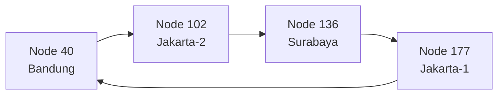
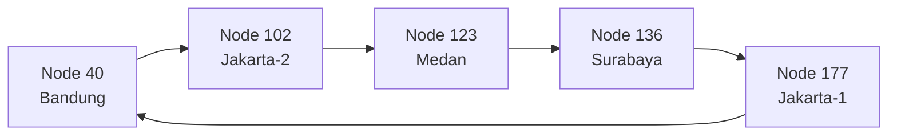

# Tugas 6 (Pekan 6) — Penamaan & Resolusi Lokasi

**Materi terkait:** Flat Naming, Structured Naming (DNS), Distributed Hash Table (DHT)/Chord.

## Studi Kasus

Pelanggan FoodGo kesulitan menemukan alamat IP server kurir yang **dinamis** (kurir berpindah lokasi/jaringan, IP-nya sering berubah). FoodGo butuh cara memetakan **ID Kurir** (identitas tetap) ke **alamat IP terkininya** tanpa server pusat tunggal yang jadi bottleneck/single point of failure.

## Tugas Kelompok

Implementasikan **simulasi Chord DHT** sederhana (single-process, tidak perlu jaringan sungguhan — cukup simulasi struktur data & algoritma di satu program Python) yang memetakan ID Kurir ke alamat IP mereka.

Konsep yang harus terlihat jalan dalam simulasi kalian:
1. **Consistent hashing**: ID Kurir dan ID Node di-hash ke ruang angka yang sama (mis. 0–255 untuk kesederhanaan, `m=8` bit).
2. **Ring topology**: node-node diurutkan melingkar berdasarkan hasil hash-nya.
3. **Lookup**: fungsi `lookup(kurir_id)` yang menemukan node mana yang bertanggung jawab menyimpan mapping ID Kurir tersebut → alamat IP-nya (aturan Chord: node dengan ID hash **terkecil yang lebih besar atau sama dengan** hash key, disebut *successor*).
4. **Perubahan topologi**: simulasikan minimal satu node baru bergabung (`join`) atau satu node keluar (`leave`), tunjukkan bagaimana mapping berpindah tanggung jawab ke node lain.

Skeleton disediakan di `src/chord_simulation.py` dengan fungsi hashing dan struktur ring sudah ada — bagian `lookup()`, `join()`, dan `leave()` sengaja dikosongkan.

### Cara Menjalankan

```bash
python3 src/chord_simulation.py
```

## Tugas Analisis (`README.md`)

1. Jelaskan **kenapa DHT/Chord** lebih cocok untuk kasus ini dibanding **flat naming sederhana** (mis. tabel pusat ID→IP) atau **DNS konvensional** — kaitkan dengan sifat "IP kurir sering berubah" dan kebutuhan tanpa titik gagal tunggal.
 - Pada kasus FoodGo, ID kurir bersifat tetap, sedangkan alamat IP dapat berubah. Chord DHT dapat digunakan untuk mencari alamat IP berdasarkan ID kurir tanpa bergantung pada satu server pusat.
 - Pada Chord, ID kurir di-hash dan dipetakan ke node yang sesuai pada ring. Sehingga hal ini juga memungkinkan pembagian data ke beberapa node.
 - Dibandingkan dengan flat naming yang menggunakan satu tempat untuk menyimpan seluruh mapping, Chord lebih cocok untuk simulasi sistem terdistribusi. DNS juga memiliki fungsi pemetaan nama ke IP, tetapi pada tugas ini yang lebih penting adalah pembagian tanggung jawab data antar-node dan perubahan topology.

2. Gambarkan (boleh pakai Mermaid, lihat Tugas 2) ring topology dari simulasi kalian, tandai node mana yang bertanggung jawab atas ID Kurir mana.
   ## 2. Ring Topology

Program menggunakan ruang identifier `0–255` (`m=8`).

Node yang digunakan:

| Node | Hash |
|---|---:|
| node-bandung-1 | 40 |
| node-jakarta-2 | 102 |
| node-medan-1 | 123 |
| node-surabaya-1 | 136 |
| node-jakarta-1 | 177 |

### Sebelum node Medan bergabung



### Setelah node Medan bergabung



Pada pengujian, `kurir-test-024` memiliki hash `109`. Sebelum node 123 masuk, kurir tersebut berada di node 136. Setelah node 123 bergabung, tanggung jawabnya berpindah:

```text
node 136 → node 123
```

Output:

```text
[MIGRASI] kurir-test-024 (hash=109) : node 136 -> node 123
```
3. Jelaskan apa yang terjadi pada mapping saat sebuah node **keluar** dari ring (siapa yang mengambil alih tanggung jawabnya) — dukung dengan output program.
- Ketika node keluar, data yang sebelumnya menjadi tanggung jawab node tersebut dipindahkan ke successor-nya.
- Pada pengujian, node-jakarta-1 memiliki hash 177 dan successor-nya adalah node 40.
- kurir-leave-001 memiliki hash 162, sehingga sebelumnya berada di node 177.

Saat node 177 keluar:node 177 menjadi node 40

Output:
[MIGRASI] kurir-leave-001 (hash=162) : node 177 menjadi node 40

Penelusuran Manual lookup()
Contoh: kurir-001
1. Hash kurir-001 menghasilkan 50.
2. Node yang tersedia: 40, 102, 136, 177.
3. Node pertama yang memiliki ID ≥ 50 adalah 102.
4. Jadi successor dari hash 50 adalah node 102.
5. Mapping kurir-001 menghasilkan IP 192.168.1.10.
   
Hasil program:
[LOOKUP] kurir-001 > hash=50 > node-102
kurir-001 > 192.168.1.10

## Struktur Submission

```
tugas-06-penamaan-dht/
├── README.md      # Analisis + diagram ring
├── JURNAL.md
├── src/
│   └── chord_simulation.py
└── bukti/          # Output program (screenshot/log) untuk skenario join & leave
```

## Rubrik Penilaian (Tugas 6)

| Komponen | Bobot | Kriteria |
|---|---|---|
| Implementasi lookup/join/leave benar | 35% | Consistent hashing & successor lookup sesuai aturan Chord |
| Bukti perubahan topologi (join/leave) | 25% | Output menunjukkan mapping berpindah dengan benar |
| Analisis kenapa DHT vs flat naming/DNS | 25% | Argumen spesifik ke kasus IP kurir dinamis, bukan definisi umum |
| Proses & kontribusi kelompok | 15% | `JURNAL.md`, commit history |

## Batasan Penggunaan AI (Level 2)

Kebijakan **Level 2 (AI Assisted Idea Generation & Structuring)** berlaku — lihat [`../RUBRIK-UMUM.md`](../RUBRIK-UMUM.md). Boleh bertanya konsep umum consistent hashing/Chord ke AI; **tidak boleh** meminta AI menuliskan isi `# TODO` di `src/chord_simulation.py` (`find_successor`, `join`, `leave`, dst). Catat pemakaian AI di "Log Penggunaan AI" pada `JURNAL.md`.

- `README.md` wajib menelusuri manual (langkah demi langkah) bagaimana `lookup()` menemukan successor untuk salah satu ID Kurir contoh yang dipakai di `chord_simulation.py` — bukan cuma menempelkan output program.
