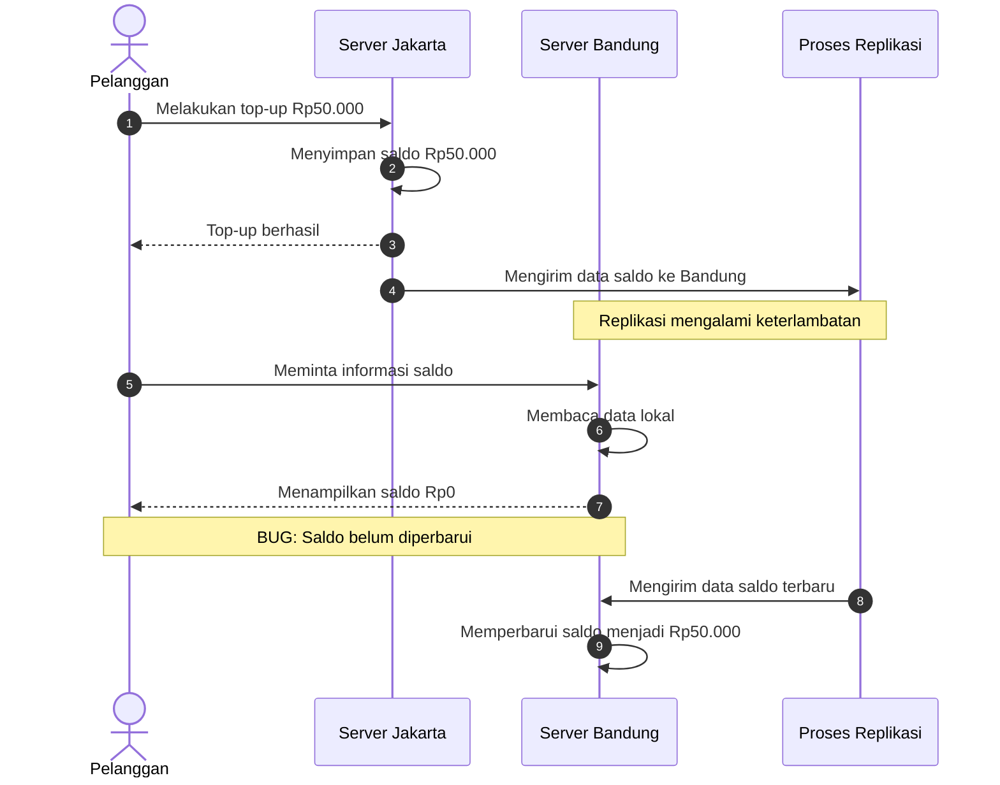
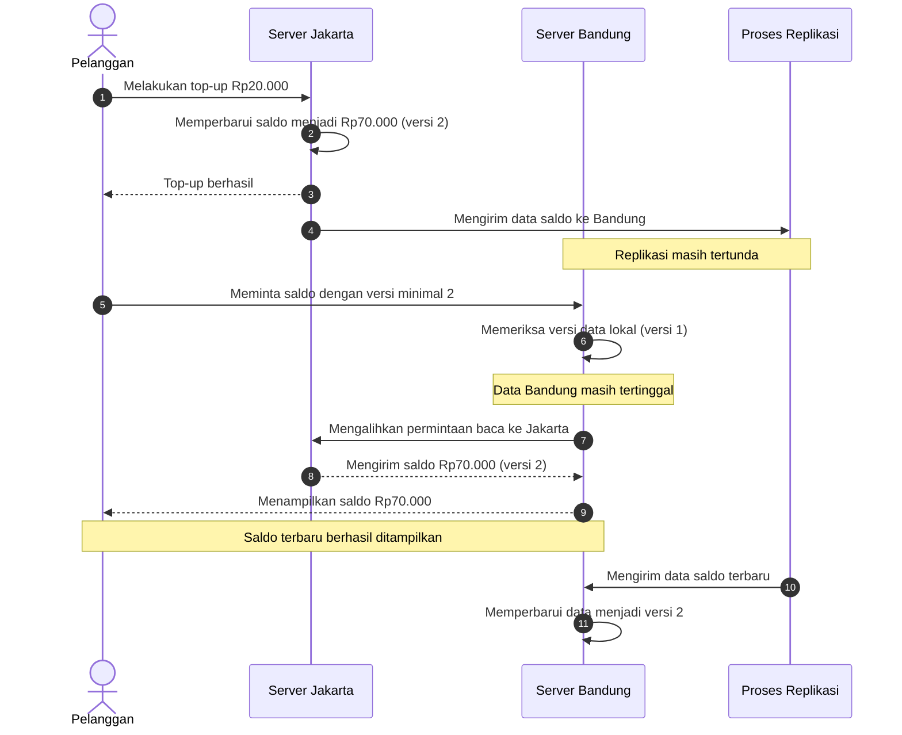

# Tugas 7 (Pekan 7) — Konsistensi Data

**Materi terkait:** Data-Centric Consistency (Sequential, Eventual), Client-Centric Consistency.

## Studi Kasus

Data saldo *e-wallet* pelanggan FoodGo berbeda antara server wilayah **Jakarta** dan **Bandung** karena replikasi antar server berjalan lambat. Contoh kasus nyata: pelanggan top-up saldo lewat server Jakarta, lalu dalam hitungan detik memesan makanan lewat aplikasi yang tersambung ke server Bandung — saldo belum ter-update, transaksi ditolak padahal saldo sebenarnya cukup.

## Tugas Kelompok

### Bagian 1 — Analisis (wajib)

1. Tentukan: apakah kasus ini **membutuhkan Sequential Consistency** (semua replika melihat urutan operasi yang sama) atau **cukup Eventual Consistency** (replika akan konsisten "pada akhirnya", boleh sementara berbeda)? Berikan argumen berbasis dampak bisnis (mis. kasus saldo *e-wallet* jauh lebih sensitif dibanding kasus "jumlah like" di media sosial).
   - Menurut kelompok kami, Eventual Consistency saja belum cukup untuk sistem e-wallet FoodGo. Alasannya, saldo berkaitan langsung dengan uang pengguna. Jika pengguna baru saja melakukan top up di Jakarta, tetapi saldo di Bandung belum diperbarui, pengguna bisa gagal melakukan pembayaran meskipun saldonya sebenarnya sudah cukup.
   - Hal ini berbeda dengan fitur seperti jumlah likes yang masih bisa mengalami keterlambatan pembaruan. Karena itu, FoodGo membutuhkan konsistensi yang lebih terjamin saat pengguna membaca saldo setelah melakukan top up.
2. Jika kalian menyimpulkan Eventual Consistency saja **tidak cukup** untuk skenario ini, usulkan pendekatan **Client-Centric Consistency** yang relevan (mis. *Read-Your-Writes*: pelanggan yang baru top-up harus selalu melihat saldo terbarunya sendiri, walau replika lain belum sinkron).
   - Kami mengusulkan menggunakan Read-Your-Writes Consistency. Artinya, setelah pengguna melakukan top up, pengguna harus bisa melihat saldo terbaru dari transaksi tersebut, meskipun membuka aplikasi dari server yang berbeda.
   - Caranya, jika server Bandung belum menerima data saldo terbaru dari Jakarta, sistem akan mengambil data terbaru dari Jakarta terlebih dahulu. Dengan begitu, pengguna tidak melihat saldo lama.
3. Gambarkan **diagram alir urutan (sequence diagram)** yang menunjukkan operasi read/write antara pelanggan, server Jakarta, server Bandung, dan proses replikasi — untuk skenario **tanpa** jaminan konsistensi (bug terjadi) DAN skenario **dengan** solusi yang kalian usulkan (bug teratasi). Pakai Mermaid (`sequenceDiagram`) di `README.md` — lihat contoh cara pakai di Tugas 2.


#### B. Skenario Dengan Read-Your-Writes (Bug Teratasi)


### Bagian 2 — Simulasi (opsional, nilai tambah)

Skeleton `src/replica_simulation.py` mensimulasikan dua replika (Jakarta & Bandung) dengan delay replikasi buatan. Lengkapi TODO untuk:
1. Menunjukkan kondisi **inconsistent read** (replika Bandung masih menunjukkan saldo lama walau Jakarta sudah update).
2. Mengimplementasikan mekanisme **Read-Your-Writes** sederhana (mis. dengan version/timestamp per client) yang memperbaiki masalah tersebut.
- Berdasarkan hasil simulasi, pada skenario tanpa Read-Your-Writes terjadi inconsistent read karena server Bandung masih menampilkan saldo Rp0 meskipun server Jakarta sudah menyimpan saldo Rp50.000. Hal ini disebabkan oleh keterlambatan proses replikasi selama 2 detik.
- Pada skenario dengan Read-Your-Writes, sistem berhasil mendeteksi bahwa versi data di Bandung masih tertinggal. Sistem kemudian mengalihkan permintaan pembacaan ke Jakarta sehingga pelanggan mendapatkan saldo terbaru sebesar Rp70.000 meskipun proses replikasi belum selesai.

```bash
python3 src/replica_simulation.py
```

## Struktur Submission

```
tugas-07-konsistensi-data/
├── README.md      # Analisis konsistensi + sequence diagram Mermaid
├── JURNAL.md
├── src/            # (opsional) simulasi replikasi
└── bukti/          # (jika mengerjakan simulasi) output program
```

## Rubrik Penilaian (Tugas 7)

| Komponen | Bobot | Kriteria |
|---|---|---|
| Ketepatan pemilihan model konsistensi | 30% | Argumen berbasis dampak bisnis nyata, bukan hafalan definisi |
| Kualitas sequence diagram | 30% | Menunjukkan jelas titik kegagalan & titik perbaikan |
| Usulan solusi client-centric | 25% | Solusi konkret dan dapat diimplementasikan (bukan wacana abstrak) |
| Proses & kontribusi kelompok | 15% | `JURNAL.md`, commit history (+ bonus jika simulasi dikerjakan) |

## Batasan Penggunaan AI (Level 2)

Kebijakan **Level 2 (AI Assisted Idea Generation & Structuring)** berlaku — lihat [`../RUBRIK-UMUM.md`](../RUBRIK-UMUM.md). Boleh bertanya konsep umum consistency model ke AI untuk brainstorming; **tidak boleh** meminta AI menuliskan analisis akhir/sequence diagram atau isi `# TODO` di `src/replica_simulation.py` yang tinggal ditempel. Catat pemakaian AI di "Log Penggunaan AI" pada `JURNAL.md`.

- Sebagai bukti pemahaman konsep (bukan hafalan jawaban skenario FoodGo saja), `README.md` wajib menyertakan **satu skenario tambahan** yang kalian buat sendiri (mis. kasus lain di aplikasi ojek online) dan menentukan model konsistensi yang tepat untuk skenario tambahan tersebut.
